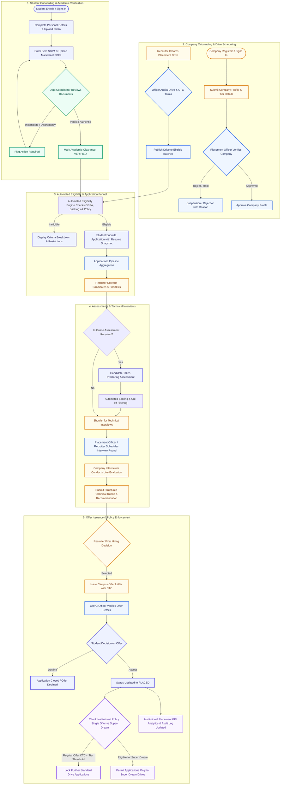
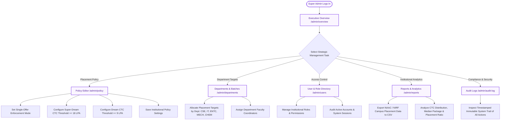
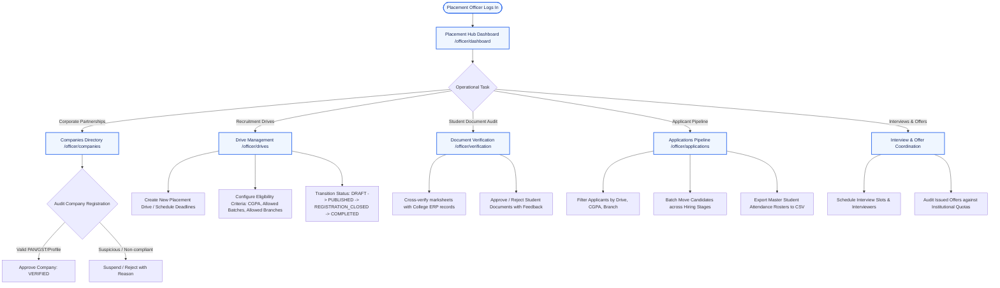
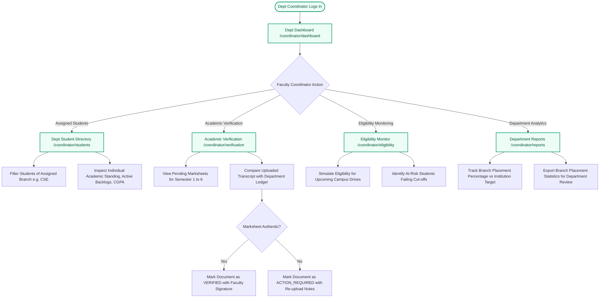
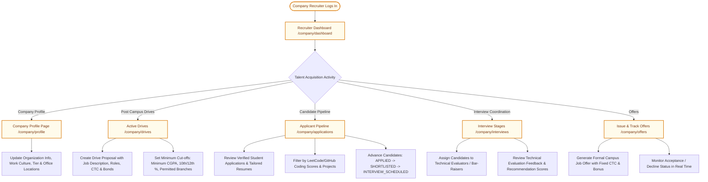
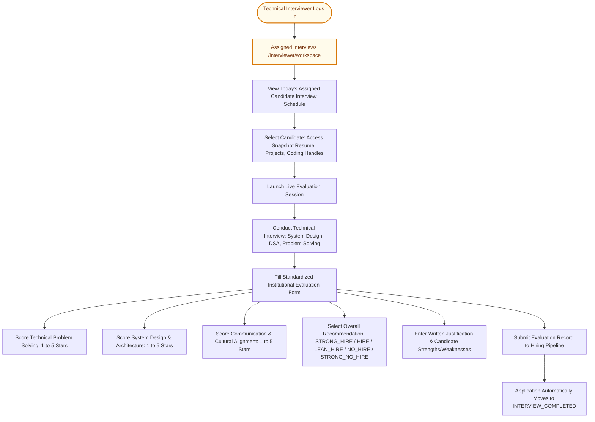
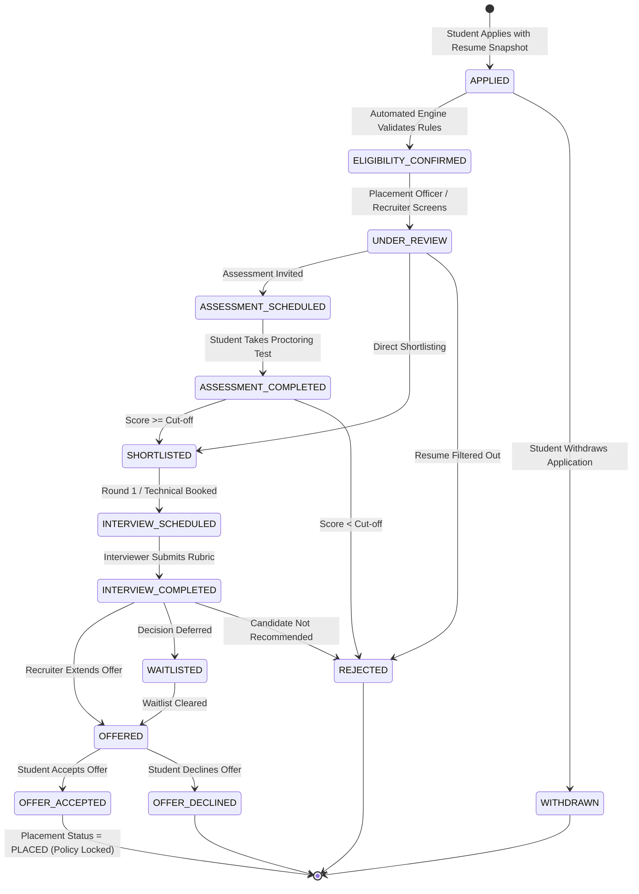

# MIT Academy of Engineering (MITAOE)
## Corporate Relations & Placement Cell (CRPC) Portal
### System User Specification & User Flow Architecture

---

## 1. Executive Summary & System Overview

The **MITAOE CRPC Portal** is an institutional campus recruitment and talent governance platform engineered specifically for **MIT Academy of Engineering, Pune**. The system enforces institutional placement policies (including single-offer rules, Dream/Super-Dream CTC tiers, and academic marksheet verification) across six distinct personas:

1. **Student (Enrolled Candidate)**
2. **CRPC Super Admin (Dean / Director of CRPC)**
3. **CRPC Placement Officer (Operational Lead)**
4. **Department Placement Coordinator (Academic Faculty)**
5. **Company Recruiter (Corporate Talent Partner)**
6. **Company Technical Interviewer (Evaluator / Bar-Raiser)**

---

## 2. User Personas & Permission Matrix

| Feature / Module | Student | Dept Coordinator | Placement Officer | CRPC Super Admin | Company Recruiter | Company Interviewer |
| :--- | :---: | :---: | :---: | :---: | :---: | :---: |
| **Personal Profile & Photo Management** | Read / Write (Self) | Read (Dept) | Read (All) | Read (All) | Read (Shortlisted) | Read (Assigned) |
| **Academic Marksheets & SGPA** | Read / Upload | Verify / Approve | Read / Audit | Read / Audit | Read (Snapshot) | Read (Snapshot) |
| **Placement Drives Directory** | Read / Apply | Read | Create / Publish | Read / Govern | Read / Manage (Own) | - |
| **Eligibility Automated Checker** | View Status | Monitor Criteria | Configure | Override / Policy | Configure Minimums | - |
| **Application Pipeline & Shortlisting** | View Own | Monitor Dept | Manage All | Oversee Analytics | Review & Move Stages | - |
| **Online Assessments / Practice** | Take Tests | View Scores | Create Official | View Analytics | Review Drive Scores | - |
| **Technical Interview Evaluations** | View Schedule | View Schedules | Schedule Rounds | Audit Reports | View Evaluations | Conduct & Score Rubric |
| **Offer Letter Issuance & Tracking** | Accept / Decline | View Dept Stats | Approve Offers | Institutional Policy | Issue Job Offers | - |
| **System Settings & Audit Logs** | - | - | Operational Logs | System Configuration | - | - |

---

## 3. High-Level Macro System Flowchart

The following diagram illustrates the complete, interconnected recruitment season lifecycle from company registration to offer acceptance and placement record closure:



---

## 4. Role-Specific Micro User Flows

### 4.1. Student User Flow (Career & Placement Space)

```mermaid
sequenceDiagram
    autonumber
    actor Student
    participant System as Portal Auth / Guard
    participant Portfolio as Student Portfolio
    participant Engine as Eligibility Engine
    participant Drive as Drives Directory
    participant Recruiter as Company Recruiter
    participant Offer as Offer Module

    Student->>System: Sign in (Email & Password / Role Switch)
    System->>Student: Redirect to /student/dashboard
    Student->>Portfolio: Navigate to /student/portfolio
    Student->>Portfolio: Add Personal Details (Photo, DOB, Gender, Addresses, Emergency Contact)
    Student->>Portfolio: Input SGPA and Upload Semester Marksheets
    Note over Portfolio: Faculty verifies marksheets
    Student->>Drive: Browse Placement Drives (/student/opportunities)
    Drive->>Engine: Evaluate Candidate against Drive Rules
    Engine-->>Drive: Eligibility Breakdown (CGPA >= 8.0, 0 Backlogs, CSE/IT, Verified)
    Student->>Drive: Click "Apply Now" (Select specific Tailored Resume)
    Drive-->>Student: Application Submitted with immutable credential snapshot
    Recruiter->>Student: Shortlist & Interview Scheduled Notification
    Student->>Student: Attend Interview & Technical Rounds
    Recruiter->>Offer: Issue Offer (e.g., 24 LPA)
    Offer-->>Student: Official Offer Letter Received Notification
    Student->>Offer: Accept Offer
    Offer-->>System: Mark student status as PLACED; enforce Single-Offer Policy
```

---

### 4.2. CRPC Super Admin User Flow (Executive Governance)



---

### 4.3. CRPC Placement Officer User Flow (Operations Hub)



---

### 4.4. Department Placement Coordinator User Flow (Academic Desk)



---

### 4.5. Company Recruiter User Flow (Corporate Partner)



---

### 4.6. Company Technical Interviewer User Flow (Bar-Raiser Workspace)



---

## 5. Candidate Application State Machine

Every campus recruitment application transitions through an immutable state machine, recorded in the system audit log with timestamps and actor credentials:



---

## 6. Summary of Key Architectural Guardrails

1. **Strict Institutional Persona Isolation**:
   - Each role is routed directly to their authorized portal prefix (`/student/*`, `/admin/*`, `/officer/*`, `/coordinator/*`, `/company/*`, `/interviewer/*`).
   - Unauthorized path access triggers automated route redirection to the persona's respective workspace console.
2. **Snapshot Integrity**:
   - When a student applies to a drive, the application creates an immutable copy of their CGPA, resume version, skills, and projects at that exact moment. Subsequent student edits do not alter previous job applications.
3. **Institutional Policy Enforcement**:
   - Single-offer policy and Super-Dream/Dream package thresholds prevent unauthorized multiple offers while encouraging high-tier talent mobility.
4. **Comprehensive Audit Trail**:
   - All state transitions, role switches, document approvals, and evaluations are logged in `cpcp_audit_logs` with timestamps, actor IDs, and target details.
